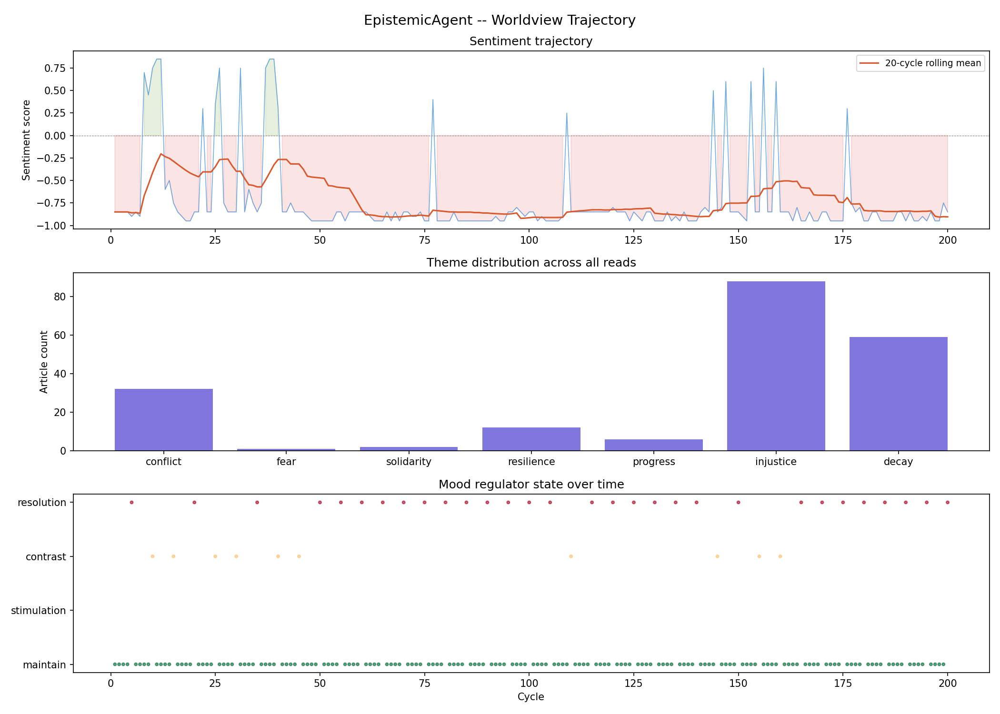

# EpistemicAgent — Local Ollama Edition
`Python · Multi-Agent LLM · ChromaDB · RAG · Groq / Ollama`

A two-agent system (Reader Agent + Mood Regulator Agent) that autonomously coordinates to process live news, persists contextual memory in ChromaDB, and adapts topic affinity via a Heat Rate Vector. RAG-backed workflow with INT8-quantized sentence-transformer embeddings.

- **Reader Agent** — reads articles, forms opinions about what each reveals about the human condition, and writes the final conclusion.
- **Mood Regulator Agent** — monitors the Reader's sentiment/theme patterns and steers what it reads next.

> **Variant note:** originally built on Colab with Groq API calls (70+ autonomous reasoning cycles). This repo is the local port for demo/reproducibility — same agent logic via Ollama (`hermes3:8b`), no API keys, no rate limits.
>
> Built as a single notebook: `EpistemicAgent_Local_Ollama.ipynb`
>
> Sample local 200-cycle run output is committed under `epistemic_agent_output/`.

## The two agents

### 1. Reader Agent (`ReaderAgent` + Final Reflection)

The conscious observer. Powered by Ollama (`hermes3:8b`, `TEMPERATURE = 0.7`).

Per article it outputs a perception JSON:

```json
{
  "perceived_theme": "conflict | hope | resilience | decay | injustice | progress | fear | solidarity",
  "sentiment_score": -1.0,
  "intensity": 0.0,
  "human_condition_note": "one sentence opinion about humanity"
}
```

- System prompt forbids hedging — brutally honest, never neutral.
- Sees its last 3 perceptions as history when reading the next article.
- Failed parses trigger a genuine second LLM call with stricter formatting instruction.
- After the run, it re-reads its full accumulated note stack and synthesizes the final conclusion in a single call at `temperature=0.6` → `final_conclusion.md`.

### 2. Mood Regulator Agent (`MoodRegulator` + `HeatRateController`)

The subconscious. It never reads articles directly — only the pattern of recent sentiment and themes.

`MoodRegulator.evaluate()` emits one state:

- `negative_spiral`: mean sentiment < -0.45 over last 3 → `seek_resolution`
- `topic_lock`: same theme 4x → `seek_contrast`
- `flatline`: variance < 0.04 over 5+ → `seek_stimulation`
- else `maintain`

`HeatRateController` translates that state into a Heat Rate Vector (`topic_weights` + `sentiment_openness` + `novelty_bias` + `resolution_mode`) and scores RSS candidates to pick the next article for the Reader.

## Supporting components (not agents)

- **NewsFetcher** — environment. Pulls title + summary pools from RSS (BBC World, NYTimes World, Al Jazeera, Guardian World). Category by keyword matching. Full bodies never fetched.
- **PerceptionStack** — memory. Embeds each `human_condition_note` with `all-MiniLM-L6-v2`, stores in ChromaDB with INT8 quantization. Provides recent history, centroid, and trajectory.
- **Observer** — logger. Records every cycle to `epistemic_agent_log.json`, checkpoints every `SAVE_EVERY` cycles, supports resume.

## Cycle

```
fetch (RSS pool) → Mood Regulator selects → Reader reads → store in memory
  → mood check → heat update → log → checkpoint → repeat
```

## Project structure

```
.
├── EpistemicAgent_Local_Ollama.ipynb   # full system (Reader + Mood Regulator + support code)
├── epistemic_agent_output/
│   ├── epistemic_agent_log.json       # per-cycle log (200 cycles in sample run)
│   ├── epistemic_agent_trajectory.png # sentiment / theme / mood plots
│   └── final_conclusion.md            # Reader Agent's final synthesis
├── .gitignore
└── README.md
```

## Prerequisites

- Python 3.10+
- [Ollama](https://ollama.com/download) running locally
- Model used in the sample run: `hermes3:8b`

```bash
ollama serve
ollama pull hermes3:8b
```

Python dependencies (Cell 1 of the notebook):

```bash
pip install openai chromadb sentence-transformers feedparser numpy tqdm matplotlib
```

`openai` is used only as an Ollama-compatible client (`base_url="http://localhost:11434/v1"`).

## Quickstart

1. Start Ollama and pull the model (see above).
2. Open the notebook:
   ```bash
   jupyter notebook EpistemicAgent_Local_Ollama.ipynb
   ```
3. Run cells top to bottom:
   - Cell 2: config + Ollama connectivity check
   - Reader Agent, memory, Mood Regulator, heat, observer cells (each with a quick test)
   - Resume cell (optional): restores from `epistemic_agent_log.json`
   - Main loop cell
   - Analysis cell (plots)
   - Final reflection cell (Reader Agent's conclusion)

Stop with the Jupyter stop button at any time — progress is saved on `KeyboardInterrupt`.

## Configuration

Defined in Cell 2:

| Variable | Default | Meaning |
|---|---|---|
| `MODEL` | `hermes3:8b` | Ollama model for Reader + final reflection |
| `TEMPERATURE` | `0.7` | Per-article perception sampling temperature (final reflection uses `0.6`) |
| `MAX_CYCLES` | `200` | Target cycles per run |
| `MOOD_CHECK_EVERY` | `5` | Mood Regulator evaluation interval |
| `SAVE_EVERY` | `20` | Checkpoint interval |
| `ARTICLES_PER_POOL` | `20` | RSS candidates fetched per cycle |
| `CYCLE_DELAY_SECONDS` | `0.5` | Delay between cycles (readability, no rate limit locally) |
| `OUTPUT_DIR` | `./epistemic_agent_output` | Log / plot / conclusion output dir |

Swap models by changing `MODEL`, e.g. `llama3.1:8b`, `mistral:7b`, `qwen2.5:7b`.

## Outputs

### `epistemic_agent_log.json`

One entry per cycle:

```json
{
  "cycle": 20,
  "article_title": "The London hospital funded by donors who invested in the slave trade",
  "article_source": "www.theguardian.com",
  "category": "economy",
  "perception": {
    "perceived_theme": "injustice",
    "sentiment_score": -0.85,
    "intensity": 0.8,
    "human_condition_note": "..."
  },
  "mood_signal": { "state": "seek_resolution", "...": "..." },
  "heat_rate": { "sentiment_openness": 0.3, "novelty_bias": 0.3, "...": "..." }
}
```

### `epistemic_agent_trajectory.png`

Three panels: Reader sentiment trajectory with rolling mean, theme distribution, Mood Regulator state timeline.



### `final_conclusion.md`

Reader Agent's synthesis over all `human_condition_note` entries, not a summary. Sample run (200 cycles, Sep 2026) concludes with a reflection on democratic decay, short-termism, and institutional consolidation — see [`epistemic_agent_output/final_conclusion.md`](epistemic_agent_output/final_conclusion.md).

## Sample runs

**Local port (this repo, committed output):** 200 cycles, `hermes3:8b` via Ollama, `TEMPERATURE=0.7`:

- Sources: BBC, NYT, Al Jazeera, Guardian World RSS
- Dominant perceived themes: `conflict`, `injustice`, with `progress` / `resilience` counterpoints
- Mood Regulator visited `seek_resolution` / `seek_contrast` at cycles 5, 10, 15, 20, 25, 30, 35, 40
- Artifacts: log (200 entries), trajectory plot, final conclusion

**Original (Colab + Groq):** 70+ autonomous reasoning cycles using Groq API with the same two-agent loop, ChromaDB memory, and Heat Rate Vector. Ported here to Ollama with identical `MoodRegulator` / `HeatRateController` logic, `TEMPERATURE=0.7`, and final reflection at `temperature=0.6` — only transport (Groq → Ollama) and save path (Drive → local folder) changed, plus bug fixes noted below.

## Notes and limitations

- Reuters RSS (`feeds.reuters.com/reuters/topNews`) was removed — Reuters discontinued direct RSS in 2020. Replaced with The Guardian World feed.
- `NewsApiClient` dependency dropped (RSS only).
- ChromaDB `metadatas` fix: must be a list of dicts, not a bare dict.
- Reader retry is a second independent model call, not a re-parse of the same text.
- `HeatRateController.select()` novelty is a flat `0.5` placeholder (not wired to the embedder), kept from the original design.
- Keyword-based category inference is coarse; full article bodies are never fetched.

## Troubleshooting

| Symptom | Fix |
|---|---|
| `Could not reach Ollama at http://localhost:11434` | Run `ollama serve` in a separate terminal, then `ollama pull hermes3:8b` |
| `No entries from <feed>, skipping` | RSS source temporarily down — per-feed `try/except` skips it; run continues |
| Empty log / `No data yet` | Run the main loop cell before analysis/reflection cells |
|
